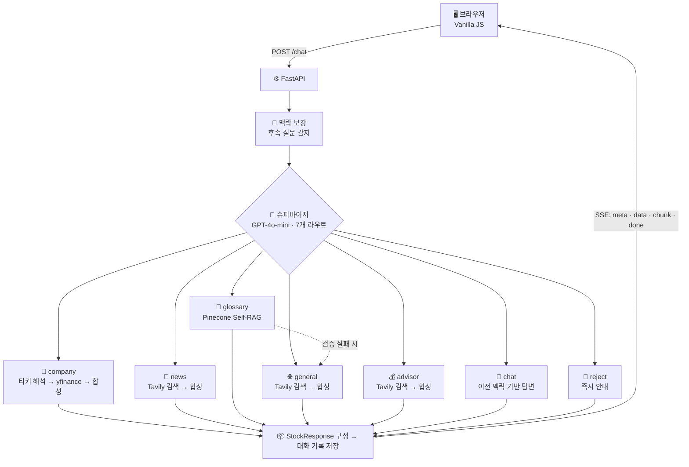
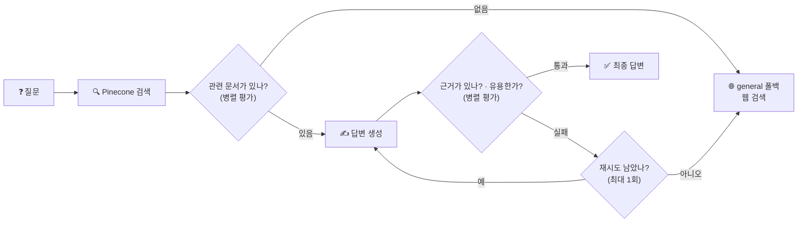

<!-- TODO: 배너 이미지 (I-ON처럼 1360×380 정도) -->

### **📈 주식 초보자를 위한 LangGraph 기반 AI 에이전트, 주식 도우미 AI**
> "PER이 뭐야?", "애플 주가 어때?"처럼 물으면 **질문 종류를 먼저 분류**해서, **실시간 데이터 · 뉴스 검색 · 검증된 용어 문서** 중 알맞은 방식으로 답합니다.

<p align="left">
  
  
  
  
  
  
  
  
  
  
  
  
</p>

| 🙋‍♀️ 개발 | 📅 기간 | 🎥 데모 | 📝 정리 글 |
|---|---|---|---|
| 1인 (개인 학습 프로젝트) | 2026.05 | 배포 준비 중 | [LangGraph, RAG, GPT-4o 활용기](https://sewondevlab.com/python-stock-ai-agent-langgraph/) |

<!-- TODO: 데모 GIF (질문 2~3개: "애플 주가 어때?", "PER이 뭐야?", "월 50만원으로 투자 시작하고 싶어") -->

---

<details>
<summary><b>📚 목차 (클릭하여 열기)</b></summary>

- [배경](#-배경)
- [목표](#-목표)
- [핵심 기능 한눈에 보기](#-핵심-기능-한눈에-보기)
- [아키텍처](#-아키텍처)
- [용어 설명 Self-RAG](#-용어-설명-self-rag)
- [설계 포인트](#-설계-포인트)
- [트러블슈팅](#-트러블슈팅)
- [배운 점](#-배운-점)
- [기술 스택](#-기술-스택)
- [실행 방법](#-실행-방법)
- [테스트](#-테스트)
- [상세 문서](#-상세-문서)
</details>

---

## 🔎 배경
주식 용어와 지표는 초보자에게 **어렵고 낯섭니다.**
게다가 같은 "주식 질문"이라도 필요한 답의 종류가 다릅니다. 주가는 **실시간 데이터**가, 뉴스는 **최신 검색 결과**가, 용어 설명은 **정확한 근거 문서**가 필요합니다.
일반 챗봇은 이런 구분 없이 답하고, 근거 없는 내용을 **그럴듯하게 말하기도** 합니다.

## 🏁 목표
- 질문을 **먼저 분류**하고, 종류에 맞는 방식으로 답하기
- 용어 설명은 **답이 근거 문서에 맞는지 스스로 검증**하기
- 느린 LLM 응답 속에서도 **필요한 정보부터 빠르게** 보여 주기
- 주식과 무관한 질문은 **정중하게 거절**하기

---

## ✨ 핵심 기능 한눈에 보기
- 🏢 **기업 분석**: 시가총액 · 가격 · PER · PBR · ROE를 카드로 표시
- 📰 **최신 뉴스 · 시장 분위기**: 신뢰 도메인으로 한정한 웹 검색
- 📖 **용어 설명**: Pinecone 용어 문서 26개 기반 **Self-RAG**
- 💰 **맞춤형 투자 안내**: 나이 · 자산 같은 조건을 바탕으로 안내
- 🔁 **후속 질문 인식**: "그건 왜 그래?"에 이전 대화 맥락을 자동으로 붙임
- ⚡ **SSE 스트리밍**: 답변을 실시간 전송, 주가 카드는 분석보다 먼저 표시
- 🚫 **무관한 질문 차단**: 주식 · 금융과 상관없는 질문은 바로 안내
- 💡 **용어 하이라이트**: 답변 속 금융 용어 40여 개에 툴팁 표시

---

## 🗺️ 아키텍처



| 라우트 | 하는 일 | 예시 |
|---|---|---|
| 🏢 `company` | 특정 기업의 가격 · 시총 · 재무지표 | "애플 분석해줘" |
| 📰 `news` | 특정 기업의 최신 뉴스 | "테슬라 최근 뉴스" |
| 📖 `glossary` | 주식 용어 · 개념 설명 | "PER이 뭐야?" |
| 🌐 `general` | 일반 시장 · 트렌드 질문 | "요즘 인기 있는 주식?" |
| 💰 `advisor` | 맞춤형 투자 안내 | "24살 월 50만원 투자 전략" |
| 💬 `chat` | 인사, 이전 답변에 대한 후속 질문 | "왜 그래?", "더 알려줘" |
| 🚫 `reject` | 주식 · 금융과 무관한 질문 | "앰플 추천해줘" |

---

## 📖 용어 설명 Self-RAG



| 단계 | 하는 일 | 파일 |
|---|---|---|
| 📄 Document Relevance | 검색된 문서가 질문과 관련 있는지 | `chains/retrieval_grader.py` |
| 🧐 Groundedness | 답변이 문서에 근거하는지 (할루시네이션 검사) | `chains/hallucination_grader.py` |
| 👍 Answer Helpfulness | 답변이 질문에 실제로 도움이 되는지 | `chains/answer_grader.py` |

---

## 🧩 설계 포인트
- 🧭 **질문 분류 먼저**: 슈퍼바이저가 7개 라우트 중 하나를 고르고, 각 노드는 자기 역할만 처리
- 💸 **모델 분리**: 답변 작성은 **GPT-4o**, 분류 · 판단 · 검색어 생성은 **GPT-4o-mini**로 나눠 비용 절감
- 🔗 **LLM 호출 최소화**: 노드를 **LCEL 체인**으로 구성하고, 응답 정리용 LLM 없이 각 노드가 최종 응답(StockResponse)을 직접 구성
- ⚡ **데이터 선행 전송**: 기업 분석은 주가 데이터를 **LLM 답변보다 먼저** SSE로 전송
- 🛡️ **출처 필터링**: 뉴스 · 투자 안내 검색은 신뢰 도메인으로 한정하고 소셜미디어는 제외

---

## 🐢 트러블슈팅

### 1️⃣ 답변이 너무 느림
- **문제**: 질문 하나에 LLM 호출이 여러 번 이어져 답변이 늦게 나왔다.
- **원인 찾기**: **LangSmith**로 노드별 소요 시간을 보고 병목 구간을 확인했다.
- **해결**: 불필요한 LLM 호출을 줄였다(체인 기반 노드, 응답 정리 LLM 제거, 가벼운 판단은 GPT-4o-mini). 기업 분석은 주가 데이터를 **LLM 답변 전에 먼저** SSE로 보내도록 바꿨다.
- **결과**: 주가 카드가 분석보다 먼저 떠서 **체감 속도가 빨라졌다.**

### 2️⃣ 용어 설명에서 사실과 다른 답변 (할루시네이션)
- **문제**: 용어 설명에서 그럴듯하지만 틀린 답이 나왔다.
- **해결**: 답변이 검색 문서에 근거하는지 평가하는 체인을 따로 만들고, 관련성 · 유용성까지 **3단계로 검증**했다. 통과하지 못하면 한 번 다시 생성하고, 그래도 실패하면 웹 검색 기반 답변으로 넘긴다.

---

## 💡 배운 점
- 강의에서 잘 동작하던 코드도 **실제 데이터를 연결하면** 예상과 다르게 동작한다. 디버깅과 구조 설계가 중요했다.
- LangGraph는 노드와 엣지로 **흐름이 눈에 보여서**, 분기가 많은 에이전트를 관리하기 좋았다.
- AI 에이전트는 GPT에 질문을 넣는 일이 아니라, **목적에 맞게 흐름을 설계하고 결과를 검증하는 일**이었다.

---

## 🧰 기술 스택
- **Orchestration**: LangGraph (StateGraph) · LangChain LCEL
- **LLM**: OpenAI GPT-4o (답변 작성) · GPT-4o-mini (분류 · 판단 · 검색어 생성 · RAG 검증)
- **RAG**: OpenAI text-embedding-3-small · Pinecone
- **Data**: yfinance (기업 데이터) · Tavily (웹 검색)
- **Backend**: FastAPI · Uvicorn (SSE 스트리밍)
- **Frontend**: HTML · CSS · Vanilla JS
- **Schema**: Pydantic Structured Output
- **Tracing**: LangSmith
- **Test**: pytest · pytest-asyncio

---

## 🚀 실행 방법

```bash
# 1. 환경 변수 설정
cp .env.example .env
# .env 파일에 API 키 입력

# 2. 의존성 설치
pip install -r requirements.txt

# 3. (최초 1회) 용어집 Pinecone 인덱싱
python rag_data/ingest.py

# 4. 서버 실행
python main.py
# → http://localhost:8000
```

<details>
<summary><b>🔑 필요한 환경 변수</b></summary>

```
OPENAI_API_KEY=sk-...
TAVILY_API_KEY=tvly-...
PINECONE_API_KEY=...
PINECONE_INDEX_NAME=stock-glossary
LANGSMITH_API_KEY=lsv2_...
LANGSMITH_PROJECT=stock-helper
LANGSMITH_TRACING=true
```

</details>

## 🧪 테스트

```bash
pytest tests/test_chains.py -v
```

> ⚠️ 실제 API를 호출하는 테스트입니다. API 키가 필요하고 호출 비용이 발생합니다.

관련성 판단 · 답변 생성 · 할루시네이션 판단 · 유용성 판단 · 슈퍼바이저 라우팅을 확인합니다.

---

## 📂 상세 문서

<details>
<summary><b>🏢 기업 분석 · 📰 검색 노드 동작</b></summary>

### 🏢 기업 분석 (company)
1. **코드 기반 티커 해석**: 한↔영 종목명 매핑(100여 개) → 영문 티커 패턴 → 한국 종목코드
2. **LLM 티커 추론**: 코드로 못 찾으면 GPT-4o-mini로 추론
3. **yfinance 데이터 수집**: `get_company_data()` 한 번 호출
4. **주가 데이터 선행 전송**: LLM 답변 전에 가격 · 지표 · 후속 질문을 SSE로 먼저 전송
5. **LLM 합성**: GPT-4o로 요약 생성 (스트리밍)

### 📰 뉴스 · 일반 · 투자 안내 (news, general, advisor)
공용 검색 체인(`_search_chain.py`)을 씁니다.
1. **검색어 생성**: GPT-4o-mini (현재 연도 자동 포함)
2. **Tavily 검색**: 신뢰 도메인 한정, 소셜미디어 제외
3. **LLM 합성**: GPT-4o (스트리밍)

</details>

<details>
<summary><b>🤖 LLM 사용처</b></summary>

| 용도 | 모델 | 파일 |
|---|---|---|
| 라우팅 (질문 분류) | GPT-4o-mini | `nodes/supervisor.py` |
| 맥락 필요 판단 | GPT-4o-mini | `agent.py` |
| 티커 추론 | GPT-4o-mini | `nodes/company.py` |
| 검색어 생성 | GPT-4o-mini | `nodes/_search_chain.py` |
| 기업 분석 합성 | GPT-4o | `nodes/company.py` |
| 뉴스 · 일반 · 투자 안내 합성 | GPT-4o | `nodes/_search_chain.py` |
| 대화 후속 답변 | GPT-4o | `nodes/chat.py` |
| RAG 검증 (관련성 · 근거 · 유용성) | GPT-4o-mini | `chains/*.py` |
| RAG 답변 생성 | GPT-4o-mini | `chains/generation.py` |

</details>

<details>
<summary><b>⚡ SSE 이벤트 (POST /chat)</b></summary>

| 이벤트 | 데이터 | 설명 |
|---|---|---|
| `meta` | `{route, thread_id}` | 라우트 분류 결과 |
| `data` | `{ticker_info, price, key_metrics, follow_up}` | 기업 주가 데이터 (LLM 답변보다 먼저 전송) |
| `chunk` | `{text}` | LLM 답변 토큰 |
| `done` | `StockResponse` | 최종 응답 |
| `error` | `{message}` | 에러 메시지 |

10초 간격 heartbeat로 프록시 타임아웃을 막습니다.

</details>

<details>
<summary><b>📁 폴더 구조</b></summary>

```
stock-helper/
├── main.py                          # FastAPI 진입점 (SSE 스트리밍)
├── requirements.txt
├── stock_agent/
│   ├── agent.py                     # 그래프 조립 + 응답 구성
│   ├── nodes/                       # supervisor, company, news, general, advisor, glossary, chat
│   │   └── _search_chain.py         # 검색 공용 체인 (news/general/advisor)
│   ├── chains/                      # RAG 검증 체인 3종 + 답변 생성
│   ├── tools/                       # yfinance, Tavily, Pinecone, 종목명 매핑
│   ├── prompts/                     # 노드별 프롬프트
│   └── utils/                       # GraphState, 상수, Pydantic 스키마, 로깅
├── rag_data/
│   ├── documents/                   # 한국어 용어 문서 (26개)
│   └── ingest.py                    # Pinecone 인덱싱 스크립트
├── tests/
│   └── test_chains.py               # 체인 단위 테스트
└── static/                          # index.html, app.js, style.css, glossary.json
```

</details>

---

### 💡 한 줄 요약
**주식 도우미 AI**는 질문을 먼저 분류해 **알맞은 방식으로 답하고**, 용어 설명은 **근거 문서로 스스로 검증**하는, 주식 초보자를 위한 LangGraph 에이전트입니다.
